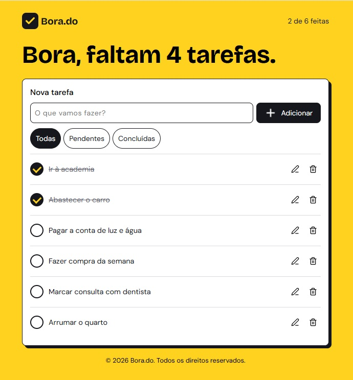

# ✅ Bora.do

    O <strong>Bora.do</strong> é uma lista de tarefas simples para organizar o seu dia. Anote o que precisa fazer, acompanhe o que falta e marque cada tarefa concluída.

  <strong>Versão atual:</strong> 1.0.0

  

    🔗Acesse o projeto: <a href="https://alcamarano.github.io/bora-do/">clique aqui</a>

 
## 📌 Funcionalidades
 
- [x] Adicionar tarefas
- [x] Editar tarefas
- [x] Excluir tarefas
- [x] Marcar tarefas como concluídas
- [x] Filtrar por todas, pendentes e concluídas
- [x] Impedir tarefas vazias
- [x] Salvar tarefas no navegador
- [x] Mostrar o progresso e as tarefas pendentes
- [x] Layout responsivo, feito com abordagem mobile-first

## 🛠️ Tecnologias
 
- **HTML:** estrutura da página
- **CSS:** estilo e layout responsivo
- **JavaScript:** regras do app e manipulação do DOM

## 🗺️ Próximos passos

### Versão 2: organização por dias

- [ ] Escolher o dia de cada tarefa ao criar ou editar
- [ ] Exibir as tarefas agrupadas por dia, em ordem de data
- [ ] Mostrar apenas as tarefas pendentes ao abrir a lista

## 👤 Autor
 
Feito por **Augusto Lima Camarano**.
 
- GitHub: [@seu-usuario](https://github.com/seu-usuario)
- LinkedIn: [Seu nome](https://linkedin.com/in/seu-usuario)

 

    © 2026 Bora.do. Todos os direitos reservados.

